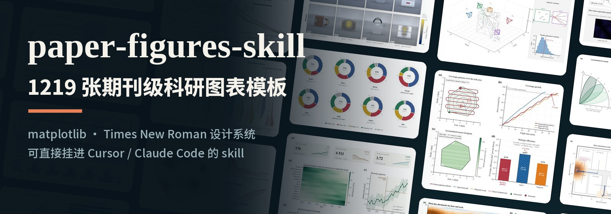
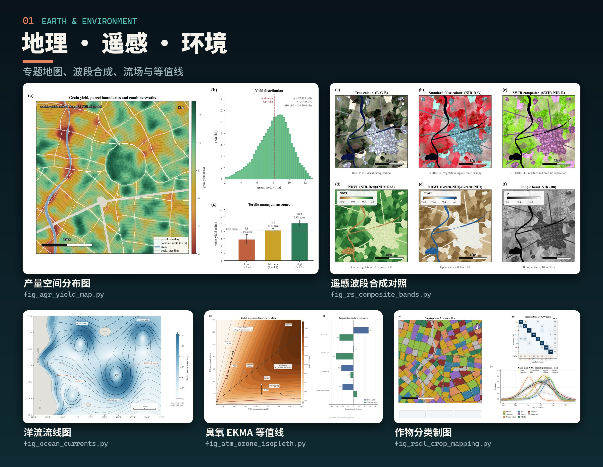
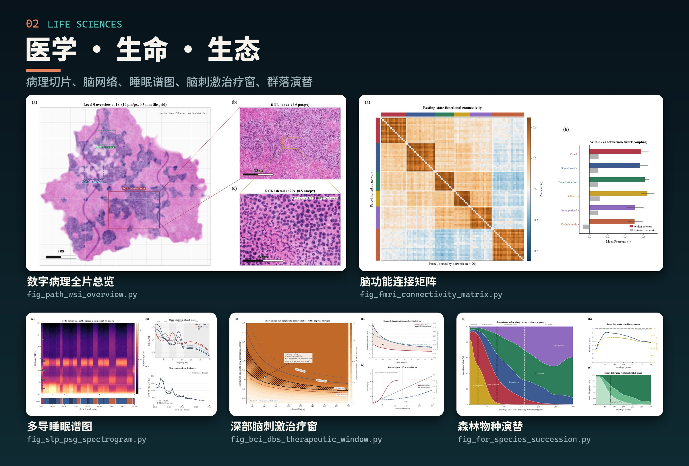
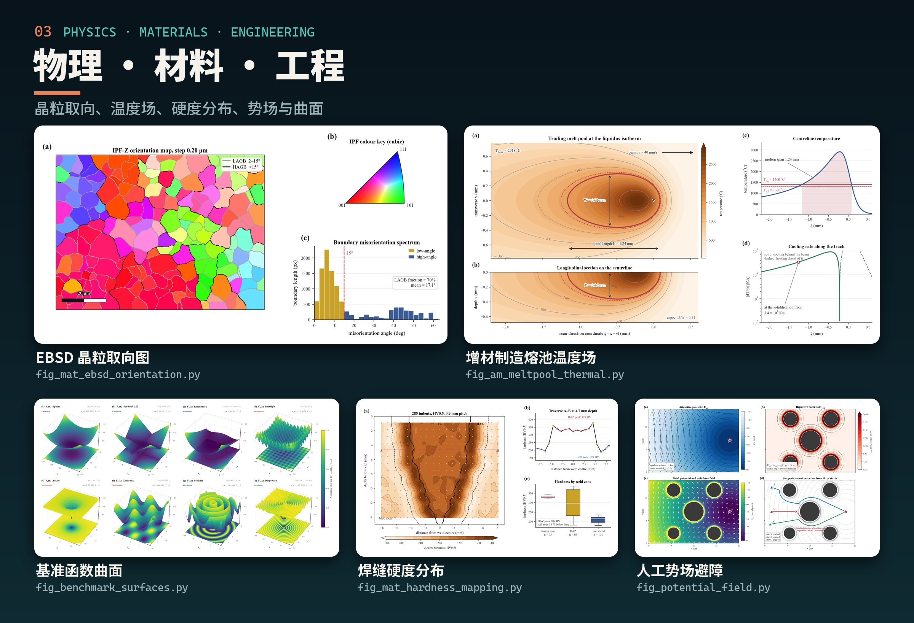
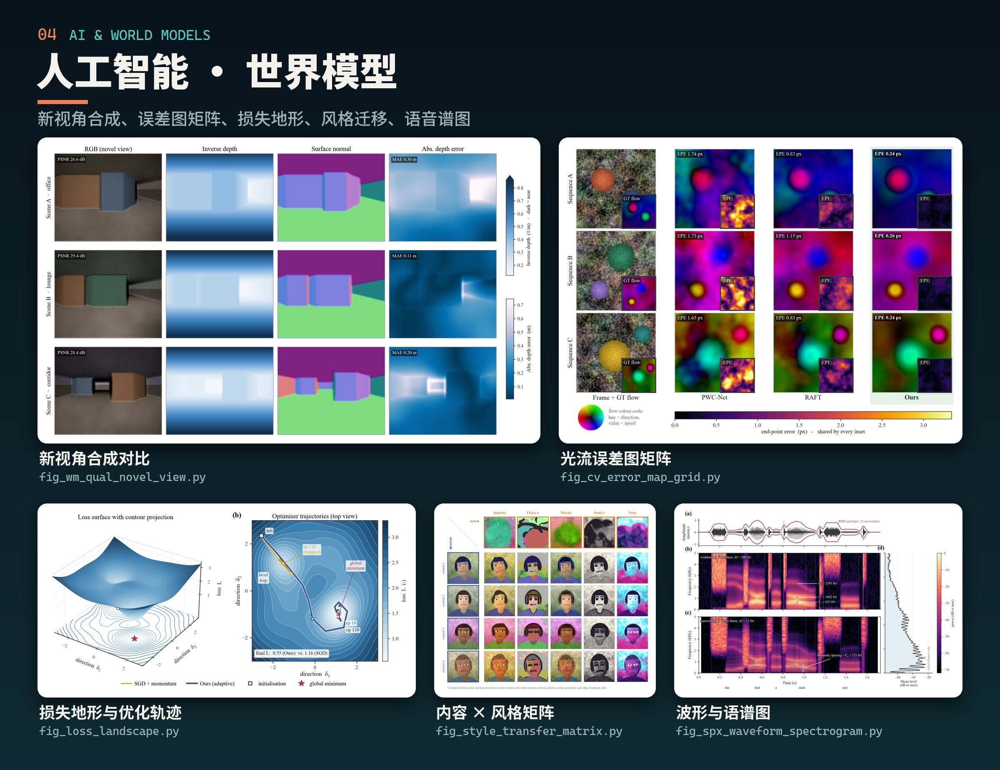
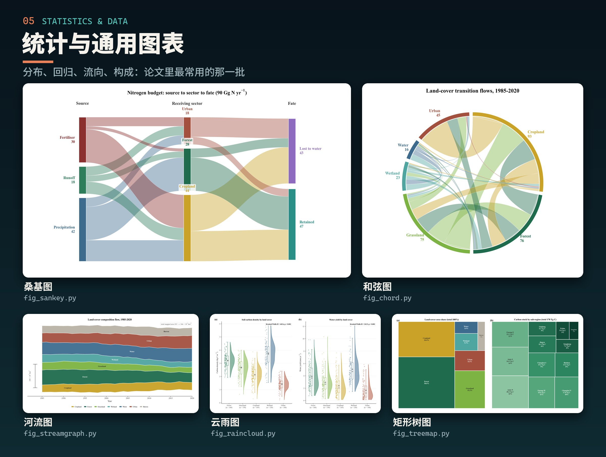

<p align="center">
  
</p>

<h1 align="center">paper-figures-skill</h1>

<p align="center">
  <b>1219 个现成的 matplotlib 出图脚本，一套 Times New Roman 期刊级设计系统。</b><br>
  可以直接挂进 Cursor / Claude Code 当 skill 用，也可以当成一个脚本库自己跑。
</p>

<p align="center">
  
  
  
  
  
  
</p>

<p align="center">
  <a href="#图库一瞥">图库一瞥</a> ·
  <a href="#这是什么">这是什么</a> ·
  <a href="#安装">安装</a> ·
  <a href="#先做自检">先做自检</a> ·
  <a href="#三种用法">三种用法</a> ·
  <a href="#目录结构">目录结构</a> ·
  <a href="#已知边界">已知边界</a> ·
  <a href="#出问题时">出问题时</a>
</p>

---

## 图库一瞥

<p align="center">
  
</p>

<p align="center">
  
</p>

<p align="center">
  
</p>

<p align="center">
  
</p>

<p align="center">
  
</p>

<p align="center">
  <sub>以上 25 张都是本库脚本直接渲染的原图，每张下面标了对应的脚本名。其余 1194 张的缩略图在
  <a href=".cursor/skills/scientific-figures/reference/thumbs/"><code>reference/thumbs/</code></a>，
  按方向分组的目录在
  <a href=".cursor/skills/scientific-figures/catalog/INDEX.md"><code>catalog/INDEX.md</code></a>。</sub>
</p>

## 这是什么

| | |
|---|---|
| **1219 张图，一图一个脚本** | 每个 `fig_*.py` 都是独立的，不带参数直接跑就出图。 |
| **135 个方向** | 从基础统计、医学、地理、材料、遥感，到 AI 与世界模型，按分组建了目录。 |
| **统一的设计系统** | 配色、字号阶梯、画布尺寸、保存参数都收在 `pubstyle.py` 里，全库一个样。 |
| **字体不用操心** | 字体栈是 Times New Roman；机器上没有时由内置的 Tinos 顶上，度量一致，排版不变。 |
| **自己的表格也能画** | `plot_data.py` 是表格数据的前门，14 种图型，csv / xlsx 直接读。 |
| **先看图再选** | 全部 1219 张的缩略图在 `reference/thumbs/`，33 张精选原图在 `reference/curated/`。 |

> 图里画的都是程序生成的示例数据，只用来演示版式和配色，不能直接当结果图用。
> 哪些脚本容易换成自己的数据、哪些不容易，见[已知边界](#已知边界)第 3 条。

## 安装

需要 Python 3.9 以上。

```bash
git clone https://github.com/wxx827/paper-figures-skill.git
cd paper-figures-skill
pip install -r requirements.txt
```

把 `.cursor/skills/scientific-figures/` 整个目录放进你项目根目录的 `.cursor/skills/`
下（本仓库已经是这个结构，直接把仓库当项目打开就行）。Claude Code 用户放到
`~/.claude/skills/` 或项目的 `.claude/skills/` 下，SKILL.md 的格式两边通用。

> 仓库叫 `paper-figures-skill`，里面的 skill 目录名是 `scientific-figures`，
> 这是 AI 识别用的名字，不要改。

## 先做自检

**装完先跑这三条。三条都干净，才说明环境没问题；出了问题请先贴这三条的输出。**

```bash
cd .cursor/skills/scientific-figures/scripts

python check_typography.py --metrics    # 必须打印 "identical (Tinos-Regular.ttf)"
python fig_threshold_regression.py      # 应在 ../output/ 生成 01_threshold_regression.png
python plot_data.py --data ../examples/sales.csv --describe
```

第一条最关键：本包的字体栈是 Times New Roman，机器上没有的话由内置的 Tinos 顶上
（度量完全一致，排版不会变）。**如果这条没打印 `identical`，后面所有图的字体都不对**，
先解决它再往下走。

## 三种用法

### 一、让 AI 按需求挑图

推荐用法，也是这个 skill 的主要用途。直接说需求，比如「我要一张带阈值的分段回归图」
「画个生存曲线带风险表」。Agent 会读 `catalog/INDEX.md` 找到对应分组，再读那一个
分组文件挑脚本。

### 二、自己直接跑某一张

在 `reference/thumbs/` 里翻到中意的，记下文件名，比如 `22_sankey.jpg`，编号后面
那段前面加 `fig_` 一般就是脚本名：

```bash
cd .cursor/skills/scientific-figures/scripts
python fig_sankey.py            # 出图到 ../output/22_sankey.png
```

不知道编号对应哪个脚本时，在 `catalog/` 里搜：

```bash
grep -ril "sankey" ../catalog/
```

### 三、拿自己的数据出图

表格数据不要从脚本改起，走前门：

```bash
python plot_data.py --data 你的表.xlsx --describe                       # 这份数据能画什么
python plot_data.py --data 你的表.xlsx --kind scatter_fit --x 列A --y 列B --group 列C
```

支持 14 种图型、csv/xlsx、编码与分隔符自动识别、`"1,234"` 和 `"12.5%"` 自动转数字、
中文列名自动挑中文字体。

要把某个具体脚本改成自己的数据，先看它的数据在哪：

```bash
python plot_data.py --contract fig_threshold_regression.py
```

## 目录结构

```
.cursor/skills/scientific-figures/
├─ SKILL.md            AI 读的主文件：怎么检索、怎么改数据、样式规范
├─ catalog/            135 个分组目录文件 + INDEX.md，覆盖全部 1219 张
├─ scripts/            1219 个 fig_*.py + 样式层 + 工具
│  ├─ pubstyle.py        设计系统（配色、字号、保存）
│  ├─ figkit.py          构图辅助（缩放插图、卡片、防重叠）
│  ├─ plot_data.py       表格数据的前门
│  ├─ run_all.py         批量重跑
│  ├─ build_reference.py 图改了以后重建 reference/thumbs/
│  └─ check_typography.py / check_figures.py   两道质量闸门
├─ fonts/              Tinos（Times New Roman 的等宽度替身，SIL OFL）
├─ examples/           示例数据
├─ reference/          thumbs/ 全部 1219 张缩略图；curated/ 33 张精选原图
├─ DESIGN_SYSTEM.md    跨图的视觉标准（画布、配色、字号阶梯、禁用色图）
└─ WORKFLOW.md         操作手册：挑图、换数据、新建图、跑闸门
```

`output/` 一开始是空的。1219 张全渲染出来约 790 MB，所以不随包分发；需要的话跑
`python run_all.py --parallel 8`，约 15 分钟。

## 已知边界

先看这里，能省很多来回。

1. **字体**：Times New Roman 不随包分发（有版权），用内置 Tinos 顶替，度量一致但
   字形有细微差别。要真 Times 的话自己在系统里装上，脚本会自动优先用它。
2. **中文**：CJK 字符靠系统里的中文字体逐字回退。Windows 上一般是宋体，macOS 上是
   苹方；机器上一个中文字体都没有时，中文会变方框。图里的英文和数字始终走 Times。
3. **换数据的难易程度不一样**。先跑 `plot_data.py --contract <脚本名>` 看清楚是哪一类：

   | 数据在哪 | 脚本数 | 换数据的难度 |
   |---|---:|---|
   | 独立的 `gen_data()` 函数 | 19 | 最容易，替换这一个函数 |
   | 别的具名函数里 | 299 | 要先读懂那个函数 |
   | 直接写在 `main()` 里 | 656 | 要在 `main()` 里找出来再改 |
   | 图本身就是一个模型 | 245 | 没有可替换的数据（卡尔曼滤波、Kaimal 谱、合成显微场景等） |

4. **合成数据**：所有脚本默认画的是程序生成的假数据，只用来演示版式和配色。
   直接拿去当结果图是不行的。
5. **不含**：没有 GUI，没有网页应用，没有联网检索，不调用任何大模型 API。
   全部是本地跑的 matplotlib 脚本。
6. **Python 版本**：`matplotlib>=3.6` 是硬底线。低于 3.6 时逐字体回退不生效，
   一个中文标签会把整张图的字体都带跑。

## 出问题时

按顺序做：

1. 跑上面「先做自检」的三条命令，把输出贴出来。
2. 单独跑那一个出问题的脚本，贴完整报错。
3. 全库体检：`python check_figures.py --jobs 8`，它会写一份 `figure_health.md`。

## 许可

代码以 [MIT](LICENSE) 许可发布。内置的 Tinos 字体使用 SIL Open Font License，
许可文本随字体文件放在 `fonts/` 下。
